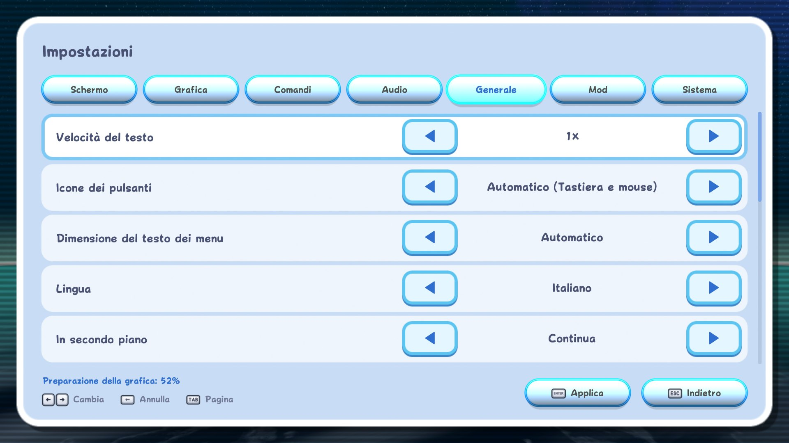

First of all, I want to preface this with the information that I do have a Ko-Fi now! I don't really want to frame this in a scummy way, as I would never charge people for an app I am trying to create for everyone to use, but donations/tips are appreciated! This project will always be free but if you do appreciate the work I'm doing and like v2 when it comes out, a little goes a long way (and maybe my Taco Bell addiction can finally be subsidized)!

Feel free to donate at [https://ko-fi.com/keepvaibin](https://ko-fi.com/keepvaibin). Once again, thank you for your support!

Hello! If you've been following Nebula for a while, you've probably noticed things got a little quiet for about three weeks. That wasn't because nothing was happening, and in fact was because quite literally *everything* was happening, and none of it was in a state I could show off yet (typical trying to cram every feature I can think of into as short of a timeframe as possible lmao). It's a lot closer to being polished now, so let's talk about it!

This post is long, but I wanted one place that explains what Nebula v2 actually is, what changed under the hood, and why I think it was worth tearing so much of the old work down to get here. If you only want the feature list, feel free to [skip ahead](#so-what-was-built). I won't be offended (but atp you should have just read the [discord announcement](https://discord.gg/2fJEdhAw2f)).


## Where we started

To understand v2, it helps to know how v1 worked.

Nebula v1.0.2 was a **recompilation**. Super Mario Galaxy is a Wii game, which means its code is PowerPC machine code made for the Wii's processor. v1 took that machine code and translated it, instruction by instruction, into C++ that your PC could compile (Specifically, your Windows computer). That's why the v1 Setup had to download a whole compiler and spend a long time building the game on your computer. It worked, and I'm still proud of it, but the result was basically the Wii's program wearing a PC costume. The game still *thought* it was on a Wii, so everything around it had to pretend to be one.

For v2, I moved Nebula to [**Petari**](https://github.com/SMGCommunity/Petari). Petari is a decompilation of Super Mario Galaxy by SMGCommunity, which means people have been turning the game's machine code back into readable C++ source code, function by function. Instead of translating machine code, Nebula now compiles the game's actual logic as normal, native code for every platform. No more compiling at install either: Setup just reads your disc and you're good to go.

That was a huge step. But honestly? It wasn't good enough for me.

## Native code isn't the same as a native game

People have clowned on me already since I say that Nebula is a "decompiled PC port of Petari", and while I don't blame them for initially thinking that I'm just using buzzwords, there is some truth to what I'm saying. See, the thing about Petari is that it's a project focused entirely on reverse engineering the original source code, which means that it WANTS to be as close to the code that Nintendo wrote as it can be. That's what makes it amazing, but it also means the code is still written *for a Wii*. Every decision in it was made for a console with 88 MB of RAM, a disc drive, a very specific GPU, and a wiimote.

So even though the code was native, it was still doing a lot of things the way a 2007 console needed them done. And when I started digging into where performance was going, a lot of it came back to that. The GPU was a big part of it, so let's start there.

## The big one: GX and the FIFO

On the Wii, the game talks to the graphics chip through an API called **GX**. The way GX works is pretty different from how modern PC graphics work.

Instead of telling the GPU "draw this model with this material," the game writes a long stream of tiny commands into a buffer called the **FIFO** (short for "first in, first out", because the GPU reads the commands in exactly the order they were written). That stream is mostly raw register writes. That means that the instructions the GPU sees are commands like setting a register to this value, loading matrices into these slots, or things like getting some vertices to draw packed in an exact byte format and being told to draw them. The Wii's GPU reads that stream as it comes in and does what it says without questioning anything.

That's a great design for a console where the game and the GPU were built for each other. It's a terrible design for a PC, phone app, etc.

When Nebula first ran on Petari, the game was still writing that FIFO stream every single frame. Then, on the PC side, Nebula had to **read the whole stream back**, decode every register write, figure out what state the GPU was supposed to be in, unpack the vertex data from the Wii's formats, and only *then* turn it into something Direct3D or Vulkan could draw. So every frame, the game was carefully packing everything into a console format, and then Nebula was immediately unpacking it again. That's double the work for no reason, and the PC side was basically running a little Wii GPU translator just to understand what the game wanted.

It also meant a lot of other console limitations came along for the ride:

- **Matrices in fixed slots.** The Wii's GPU holds matrices in a small, fixed memory, so the game loaded them into slots like register writes. Nebula was getting hundreds of matrix commands per frame that didn't draw anything at all.
- **The TEV.** The Wii doesn't have programmable shaders like a modern GPU. It has a fixed-function color combiner called the TEV (texture environment), and every material in the game is a little TEV program. All of those had to be emulated with generated shaders, including the Wii's 8-bit math wrapping behavior, even in places where values could never overflow.
- **Tricks for missing hardware.** The Wii has no stencil buffer, so the game draws shadows by counting in the alpha channel of the frame and copying the screen around. On a PC, that's a lot of extra screen copies for something modern GPUs do directly.
- **Sending the same thing over and over.** Because GX is just a command stream, materials got resent every time they were drawn. In a typical frame, around 70% of the material data Nebula received was a repeat of something it had already been sent.

So in v2, all of that is gone. The game no longer writes a FIFO stream at all. Instead, it builds a **draw list** every frame: a list of real objects (this mesh, this material, these matrices, this light setup) and hands it to the renderer by swapping a single pointer. There's no command stream to parse, no register state to reconstruct, nothing to decode. The renderer just walks the list. This is a lot closer to how modern games render their frames/scenes, and something I wanted to achieve.

And because the data is real objects now, a lot of things got better on top of that:

- **Models are cooked into a native format** when you import your disc, instead of being read from the Wii's J3D model format every time. The game's whole J3D model library is gone.
- **Materials are real objects** with their own constants. They're uploaded once and only updated when something actually changes, instead of being resent every draw.
- **Each model sends its matrices once per frame as one block**, and skinning happens on the GPU.
- **Shadows use the stencil buffer**, like a modern game would, instead of alpha counting and screen copies.
- **The game blends color at 10 bits per channel** instead of 8, with one dither at the very end. That gets rid of the banding you'd see in skies and gradients, and the old "deband" passes are gone.
- **Every pipeline the game needs is known ahead of time**, so they get prepared at start instead of being built mid-gameplay. That means less stutter the first time you see something new.
- **Direct3D 12 and Vulkan share one code path** for walking the draw list. That's what made it possible to add Direct3D 11 and Metal renderers on top of it without rewriting everything.

Getting rid of the FIFO is also what made the newer features possible. Things like frame interpolation, DLSS, and frame generation need to know exactly which object is which from one frame to the next, and how it moved. With a raw command stream, you're guessing from the final picture. With a draw list, every object has an identity, so Nebula can pair this frame's version with last frame's version directly. That's honestly the biggest reason this whole rewrite happened.

Once I had a good look at every piece of data as it flowed through the game, I couldn't really unsee the rest of the issues that popped up, as the GPU wasn't the only thing that was using old or outdated implementations. So for the past three weeks, I went through every area of the code, one system at a time, and rewrote or refactored it so it no longer depends on decisions made for a 2007 console. Here's the short version of what changed:

**Audio.** The Wii has a separate audio chip (a DSP) that runs its own little program to mix sound. v1 ran that DSP program. In v2, the game's sound is mixed natively in floating point, at your sound device's own sample rate, with room for thousands of voices at once. The original JAudio library is gone too, replaced with Nebula's own sound engine. The music itself (the sequences) stays exactly as it was, because that *is* the music. This actually allows me to classify and sort the audio in the game, leading to a fully customizable audio experience, allowing you to individually control which sounds (voices, cutscene, music, ambience) you want to change, independent of the others.

**Loading.** The game was built to load from a disc, with a loader thread, a request queue, packed archives and big preload lists, all because the Wii only had a little bit of RAM. On a PC, that's all unnecessary. In v2, files are found the moment the game asks for them, larger ones are mapped straight from your imported game files instead of being copied, and the whole preloading system is gone. This means that loads, saves, etc. are all much faster since I'm not trying to mimic the Wii anymore.

**Memory and limits.** The Wii version has fixed caps all over the place: a set number of coins, Star Bits, collision hits, objects, and so on,per level, whenever you loaded into it because memory was tight. In v2, those grow as needed. The game's console memory heaps were replaced with arenas that clean up after each scene.

**Saves.** The Wii saved to its internal storage (NAND) through a whole sequence of checks and backup copies. In v2, your save is a normal file (`Nebula.sav`) written safely, so a crash mid-save can't corrupt it. Old saves are imported once.

**Input.** The game was written around the Wii Remote, so things like the spin were literally accelerometer math. In v2, there's an action layer instead: a spin is a spin, a pointer is a pointer, no matter what you're holding. A real Wii Remote still works, it just gets translated into those actions at the edge like every other controller.

**The screen.** The game used to lay everything out on a fixed 640×456 canvas (the Wii's screen) and stretch it. In v2, everything is placed as a fraction of your actual screen, at any resolution or aspect ratio.

**Text and menus.** The Wii's layout and font libraries (nw4r) are gone. Menus are drawn by Nebula's own UI code, and fonts are now signed distance fields, so text stays sharp even at 4K. You'll still need your own texture packs for other UI elements.

**Particles, Miis and math.** The game's particle system, its Mii library and its math library were all replaced with native versions. Particle data is cooked at import, Mii faces are drawn on the GPU, and the math uses native types (with SIMD where it gives exactly the same results as before, down to the bit).

What *didn't* change is just as important: the game logic. Mario's physics, gravity, enemies, the 60 updates per second, the random numbers didn't change, and that keeps the gameplay relatively the same to the original. Every change above was tested against the original behavior, and the game plays the way you remember it.

This did throw away a lot of earlier progress, though. Some things I'd spent a couple of weeks on got deleted because the new design didn't need them anymore. HOWEVER, it's also what let me see every piece of data instead of guessing from the final frame, and that's what everything below is built on.

## So, what was built?

Some of this has been in the works for a while and I never fully updated you on it, so here's everything that's changed since v1.0.2.

### More platforms (and more discs)

Nebula v2 runs on **Windows**, **Linux** (including the Steam Deck), **macOS**, and **Android**. On Windows you get three renderers in one install, Direct3D 12, Direct3D 11 (for older GPUs that don't support 12) and Vulkan, and you can switch between them in the settings. Linux uses Vulkan on both x86-64 and ARM64, macOS uses Metal, and Android uses Vulkan, with support for custom drivers like Turnip on Adreno GPUs.

The **European and Japanese discs** are supported now too, not just the North American one, along with all 14 of the game's languages. Nebula's own menus are translated into all 14 as well.




Setup is a lot simpler. It no longer compiles anything, so it just reads your disc image (ISO, RVZ, WBFS and others) and prepares the game files. You can also make a **portable install**, with the game, saves and settings all in one folder. Updates are signed and checked before they install, and on Windows, Setup installs the new version and starts Nebula back up for you.

### Graphics

- **Upscaling:** DLSS, FSR 1, FSR 3, XeSS, SGSR 2 and MetalFX.
- **Frame generation:** native interpolation for displays faster than 60 Hz, plus DLSS Frame Generation and FSR frame generation on supported GPUs, and NVIDIA Reflex.
- **Ray Tracing:** a completely overhauled and rewritten lighting engine to work for real-time lighting and reflections.
- **Anti-aliasing:** MSAA, SMAA, FXAA and DLAA.
- **Ambient occlusion** (SSAO or GTAO), **HDR** output, and a lighting setting with the original per-vertex lighting, per-pixel, or enhanced.
- **Bloom** from 0 to 200%, anisotropic filtering, and curved surfaces that round out the outlines of curved models.
- **Dynamic resolution** and a **Performance preset** for weaker hardware. The first time you start, Nebula picks a resolution your GPU can handle.
- **Texture packs** in Dolphin's format and **replacement movies** (MP4, MKV or WebM).


### A real benchmark

v2 has a built-in benchmark. It warms up each scene first (so loading doesn't mess with the numbers), then measures each one for a fixed amount of time with all input turned off. You get your average FPS, your 10% and 1% lows, a frame rate graph, how much time each part of the frame takes, and recommended settings for your PC that you can apply with one button. If you want to, you can also send me your results, which helps me find what's slow on hardware I don't have. That's always by choice and not by requirement, and the report never includes anything personal. It will also require internet access.


### Controllers

On top of keyboard and mouse, Xbox, and Switch Pro controllers from v1:

- **PlayStation** controllers (DualShock 4, DualSense and DualSense Edge), including pointing with the touchpad.
- The **Steam Deck** and both **Steam Controllers**, with gyro (and pointing with the right trackpad on the original Steam Controller).
- **Joy-Con**, paired as a set.
- **Generic controllers** of pretty much any kind.
- **Gyro pointing** on any controller with motion sensors.
- **A real Wii Remote**, with the Nunchuk and MotionPlus, on Windows and Android.
- **Co-Star mode**, where a second controller gets its own pointer to collect Star Bits.
- **Native button icons** for each controller type including keyboard/mouse, with an HD texture pack releasing for it on release day for v2.

### Quality of life

- **Skip cutscenes**, and **dialogue speed** all the way up to Instant (Rosalina's storybook included).
- **35 achievements**, with pop-ups as you earn them. After your first Grand Star, a Luma in the Comet Observatory shows all of them along with your play stats. Mods can add their own achievements too!
- **Mii import** for your save file icons, from a Wii, 3DS, Wii U or Switch.
- **Save import and export** right in the game, from a Wii, Dolphin, or even the Switch release. Your current save gets backed up first.
- **Seven separate volume sliders**, each from 0 to 200%.
- **Discord status** that shows the galaxy and mission you're on.
- **Every setting is in the game's own menu** now, on every platform. No separate launcher app.


- **Error codes** that save a report if something goes wrong, so it's way easier to figure out what happened.

## LumaCore and LumaLink

This is the part I'm most excited about.

**LumaCore** is Nebula's new modding engine, and it's built to support quite literally anything you could want to change in the game. Mods can hook into the game's own functions (running code before, after, or instead of them), call any function in the game, add new objects, stages, models, animations, effects, music, movies, menus and text, and change every table the game reads. There are also services for things like input, saves, files, networking, audio and drawing, and each one is behind a permission the player has to grant, so a mod can't touch your saves or go online unless you want it to.

The best part is that mod code is **real native code**. There's no scripting interpreter running inside the game, so mods run at full speed. And one `.luma` file works on every platform and every disc.

**LumaLink** is the app you use to make them. You can install it **today** on Windows, macOS and Linux (x64 and ARM). It has a normal window and a command line, and it comes with everything you need, the compiler included. With it you can:

- Write mods in **LumaScript**, a new language I made to make writing mods way easier. You can use any function, class or field in the game just by its name, and LumaLink checks every name against the game when you build. So if you typo something, you get an error right away instead of a crash later. If you'd rather write C, that works too.
- Build, check, and test your mods before you share them.
- Hit **Play in Nebula** and your mod's code reloads live while the game is running.
- Convert existing **Riivolution mods** and **texture packs** into `.luma` files.

Here's a tiny LumaScript example that counts how many times Mario jumps:

```lumascript
var jumps: i64 = 0

hook before Mario::tryJump() {
    jumps += 1
    log "jump {jumps}"
}
```

The documentation is pretty extensive. There's a getting started guide, explanations of how everything works, and full tutorials for things like adding a new galaxy, a new NPC, a new power-up, a ghost time trial, a LiveSplit link, and even an online leaderboard. I really want to see what you all come up with, so please share anything you make!

- **Download LumaLink:** [LumaLink releases on GitHub](https://github.com/keepvaibin/lumalink/releases/latest)
- **Modding documentation:** [Nebula modding docs](/modding/docs/)
- **Make your first mod:** [Quickstart for Nebula mods](/modding/docs/get-started/quickstart/)

## Wrapping up

v2 has been a lot. It's a different program from v1 in almost every way that matters, and for a lot of it you'll never see directly. But you'll feel it in how it runs, in how many places it runs, and in everything people will be able to build on top of it.

I want to say a huge thank you to SMGCommunity for Petari, because none of this would exist without their work, and to all of you for being so patient! And thank you to everyone who's been following Nebula while I've been working on v2. I'm excited to finally share all the progress.

If you run into anything weird, please report it on GitHub or in the Discord. I read all of it.

See you in the stars! ⭐
