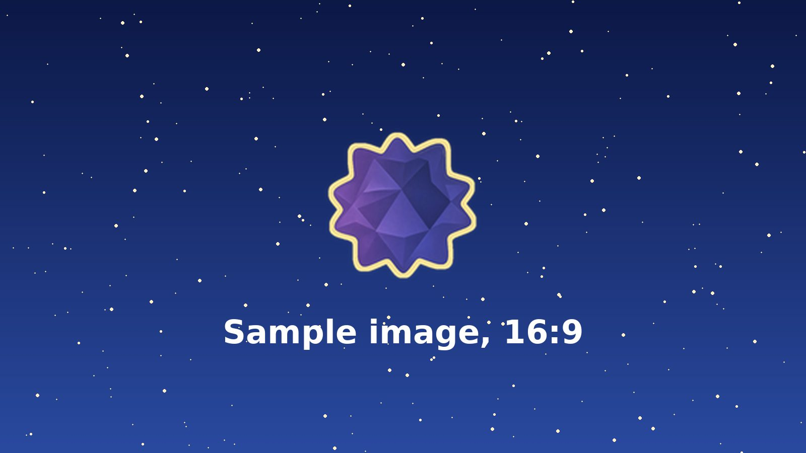
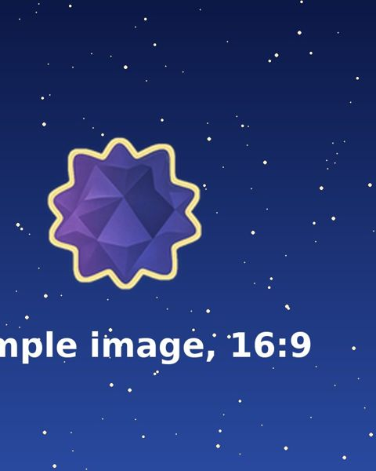

This sample shows every kind of content the Developer Blog supports. It is a draft, so it never appears on the live site. To see it while you write, run `npm run blog:drafts`.

## Text

Write paragraphs as plain text, with a blank line between them. Use **bold**, *italics*, ***both***, ~~strikethrough~~ and `inline code`.

### Sizes

Headings set the size of a section title: `##` is the largest heading in a post, then `###`, then `####`.

For a phrase in a paragraph, use <span class="text-small">smaller text</span>, <span class="text-large">larger text</span> or <span class="text-xlarge">much larger text</span>. <small>A whole small note, such as a footnote, can use the small tag.</small>

## Links

Link to [another post](../nebula-v2/), to a [page on the site](/play/mods/), to a [section of the modding docs](/modding/docs/get-started/quickstart/), to a [heading in this post](#tables) or to an [external site](https://github.com/keepvaibin/nebula).

## Lists and quotes

- A bulleted list item
- Another item, with **bold** text
  - A nested item

1. A numbered step
2. The next step

> A blockquote, for a quote or an aside.
>
> It can have several paragraphs.

## Code

```lumascript
var jumps: i64 = 0

hook before Mario::tryJump() {
    jumps += 1
    log "jump {jumps}"
}
```

## Tables

| Setting | Default | Range | Notes |
|---|---|---|---|
| Internal resolution | Match display | 144p to 2160p | Lower this first if the game runs slowly. |
| Bloom | 100% | 0 to 200% | Personal preference. |
| Interpolation target | Match refresh | 60 to 360 FPS | Uses more GPU time at higher rates. |

## Images

An image on its own line sits between paragraphs, at the width of the article, with its caption under it:



A tall image keeps its shape:



An image from another site works the same way:


## Videos

A video file from this post's folder:


A video from YouTube:


A video file from another site:


